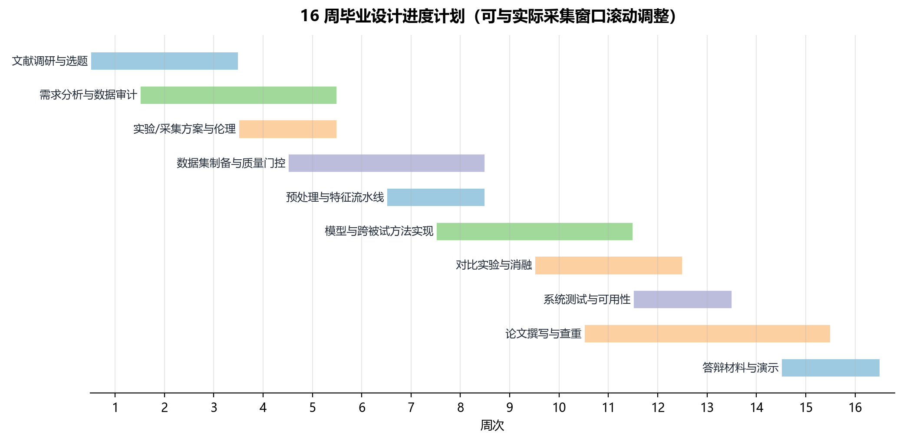

# 项目计划与工作分解结构（WBS）

**项目**：EEG-EmoStudio 脑电情绪识别数据制备与模型训练工作台  
**文档编号**：03  
**版本**：V1.0  
**日期**：2026-11-07  
**周期**：16 周（可按采集窗口滚动调整）

---

## 1. 项目目标与交付物

### 1.1 目标

在 16 周内交付：

1. 可运行的数据制备与模型训练系统；
2. 真实数据审计报告与选材清单；
3. 真实 EEG 上至少一轮 LOSO 实验（若采集按期）；
4. 完整毕业设计文档与论文初稿；
5. 答辩演示与可复现实验包。

### 1.2 交付物清单

| 编号 | 交付物 | 形式 | 验收人 | 截止 |
|---|---|---|---|---|
| D1 | 需求规格说明书 | DOCX/MD | 导师 | W4 |
| D2 | 数据审计报告 + 审计工作簿 | DOCX/XLSX | 导师/课题组 | W4 |
| D3 | 选材清单（80 条示例） | CSV/XLSX | 实验员 | W5 |
| D4 | 预处理/特征流水线 | 代码+测试 | 开发者 | W8 |
| D5 | 模型与 LOSO 评估 | 代码+报告 | 导师 | W11 |
| D6 | 系统测试报告 | DOCX | 导师 | W13 |
| D7 | 用户手册 | DOCX | 课题组 | W13 |
| D8 | 论文初稿 | DOCX | 导师 | W14 |
| D9 | 答辩 PPT/演示 | PPTX | 答辩组 | W16 |
| D10 | 可复现实验包 | 目录+哈希 | 评审 | W16 |

---

## 2. 工作分解结构

### 2.1 WBS 表

| WBS | 任务 | 产出 | 依赖 | 工期（人日） | 负责人 |
|---|---|---|---|---|---|
| 1 | 项目管理 | 计划、周报、风险表 | — | 8 | 学生 |
| 2 | 文献与研究设计 | 综述、研究问题、假设 | — | 10 | 学生 |
| 3 | 需求分析 | SRS、用例、数据字典 | 2 | 8 | 学生/导师 |
| 4 | 数据审计 | 审计报告、问题清单 | 3 | 6 | 学生 |
| 5 | 实验与采集方案 | 协议、伦理材料、问卷 | 3 | 6 | 学生/导师 |
| 6 | 刺激筛选 | 选材清单、平衡检查 | 4 | 4 | 学生 |
| 7 | 数据采集 | 原始 EEG、元数据 | 5 | 15 | 学生/实验员 |
| 8 | 预处理与特征 | 代码、参数、特征集 | 6,7 | 8 | 学生 |
| 9 | 数据集与划分 | manifest、folds | 8 | 4 | 学生 |
| 10 | 基线模型 | MLP/DGCNN/EEGNet | 9 | 8 | 学生 |
| 11 | 提出方法 | DualView-MultiProto | 10 | 10 | 学生 |
| 12 | 实验与消融 | 指标、图表、统计 | 11 | 12 | 学生 |
| 13 | 系统集成 | CLI、报告、异常处理 | 8–12 | 6 | 学生 |
| 14 | 测试与验收 | 测试报告、缺陷修复 | 13 | 6 | 学生/评审 |
| 15 | 论文撰写 | 初稿、修改、查重 | 12 | 15 | 学生 |
| 16 | 答辩准备 | PPT、演示、讲稿 | 15 | 4 | 学生 |

**合计**：约 129 人日（含采集与写作），按 5 天/周折算约 26 周单人不加班；因此必须并行与裁剪，见 §2.3。

### 2.2 优先级裁剪

| 优先级 | 范围 | 说明 |
|---|---|---|
| Must | 审计、选材、特征、LOSO、MLP/DualView、测试、论文 | 毕业设计底线 |
| Should | DGCNN/EEGNet 对照、消融、HTML 报告 | 提升论文完整性 |
| Could | UDA、多模态、Web 界面 | 时间允许再做 |
| Won't | 临床验证、大规模采集、实时 BCI | 明确不做 |

### 2.3 关键路径

```text
伦理审批 → 采集 → 预处理 → 特征 → 划分 → 训练 → 论文数字
```

关键路径上的最大不确定性是**伦理审批与采集**。对策：

- W3 前提交伦理材料；
- W5 前完成 5–10 人预实验；
- 若 W8 仍未拿到正式数据，切换到 SEED/DEAP 公开数据完成方法验证；
- 自采数据作为扩展，不阻塞软件与论文主体。

---

## 3. 进度计划

### 3.1 16 周里程碑

| 周 | 里程碑 | 交付/检查 |
|---|---|---|
| W1 | 选题确认 | 研究问题、边界 |
| W2 | 文献综述初稿 | 20+ 篇文献、缺口 |
| W3 | 需求基线 | SRS v1.0、用例 |
| W4 | 数据审计完成 | 审计报告、问题清单 |
| W5 | 采集方案/伦理提交 | 协议、知情同意、问卷 |
| W6 | 预实验 | 5–10 人数据、参数初筛 |
| W7 | 预处理冻结 | 滤波/伪迹/重参考参数 |
| W8 | 特征与数据集 | features.npz、manifest、folds |
| W9 | 基线结果 | MLP/DGCNN/EEGNet |
| W10 | 提出方法初版 | DualView-MultiProto |
| W11 | 主实验 | LOSO 指标、CI |
| W12 | 消融与统计 | 双视角/多原型/域适应 |
| W13 | 系统测试 | 测试报告、缺陷关闭 |
| W14 | 论文初稿 | 完整章节、图表 |
| W15 | 查重/修改 | 定稿、附件 |
| W16 | 答辩 | PPT、演示、问答 |

### 3.2 甘特图



> 图中条形的起止为相对周次；实际执行以周报为准。采集窗口若后移，W9–W12 可整体顺延，但论文送审时间不变，因此必须提前准备公开数据兜底。

---

## 4. 角色与职责

| 角色 | 职责 | 投入 |
|---|---|---|
| 学生（项目经理/开发/实验） | 需求、设计、编码、实验、论文 | 全职 |
| 指导教师 | 选题、方法、伦理、论文指导、评审 | 每周 1 次 |
| 课题组/实验员 | 设备、采集、材料、被试招募 | 采集期 |
| 被试 | 完成实验与自评 | 每人 1–2 h |
| 评审/答辩组 | 阶段评审、答辩 | 节点 |

---

## 5. 估算与资源

### 5.1 工作量估算

| 阶段 | 人日 | 占比 |
|---|---:|---:|
| 文献/需求 | 18 | 14% |
| 数据/采集 | 25 | 19% |
| 实现 | 30 | 23% |
| 实验/分析 | 22 | 17% |
| 测试/文档 | 18 | 14% |
| 论文/答辩 | 16 | 12% |
| 合计 | 129 | 100% |

### 5.2 资源

- 开发机：Windows 11，Python 3.12，CPU（可加 GPU）；
- 存储：≥100 GB（媒体+特征+检查点）；
- EEG 设备：课题组现有；
- 软件：全部开源，无许可费用；
- 被试报酬：按课题组标准。

### 5.3 预算（不含被试报酬）

| 项目 | 金额 |
|---|---:|
| 软件 | 0 |
| 云 GPU（可选） | 0–3,000 元 |
| 存储/备份 | 0–500 元 |
| 打印/装订 | 300–600 元 |
| 合计 | 300–4,100 元 |

---

## 6. 质量计划

### 6.1 质量目标

- P0 需求实现率 100%；
- 单元/集成测试通过率 100%；
- 审计计数与既有报告一致；
- LOSO 无泄漏；
- 文档与代码数字一致；
- 论文查重率低于学校要求。

### 6.2 评审节点

| 评审 | 时间 | 输入 | 输出 |
|---|---|---|---|
| 需求评审 | W3 | SRS、用例 | 评审意见、基线 |
| 设计评审 | W5 | 概要/详细设计 | 设计基线 |
| 代码评审 | 每周 | diff | 缺陷清单 |
| 实验评审 | W11 | 指标、图表 | 是否补实验 |
| 论文评审 | W14 | 初稿 | 修改清单 |
| 答辩预演 | W15 | PPT | 改进项 |

### 6.3 缺陷管理

| 级别 | 定义 | 处理时限 |
|---|---|---|
| S1 | 数据错误/泄漏/结果不可复现 | 24 h |
| S2 | 主要功能失败 | 3 天 |
| S3 | 次要功能/体验 | 1 周 |
| S4 | 文档/文案 | 2 周 |

---

## 7. 风险登记册

| ID | 风险 | 概率 | 影响 | 触发信号 | 应对 | 负责人 |
|---|---|---|---|---|---|---|
| R-01 | 伦理审批延迟 | 高 | 高 | W3 未提交 | 提前准备；公开数据兜底 | 学生/导师 |
| R-02 | 被试招募不足 | 中 | 高 | W6 <5 人 | 扩大招募；缩短单次实验 | 实验员 |
| R-03 | 设备/事件不同步 | 中 | 高 | 事件偏移>50 ms | 预实验校准；双记录 | 学生 |
| R-04 | 标签噪声/诱导失败 | 高 | 中 | 一致率<0.6 | 质量门控；剔除/敏感性分析 | 学生 |
| R-05 | 跨被试性能低 | 中 | 高 | 低于随机+10% | 多基线；域适应；诚实报告 | 学生 |
| R-06 | 工作量超期 | 中 | 高 | W8 未完成特征 | 裁剪 P1；冻结范围 | 学生 |
| R-07 | 数据泄漏 | 低 | 极高 | 评审发现 | 代码断言；独立复核 | 学生/导师 |
| R-08 | 版权/隐私问题 | 低 | 高 | 投诉/审查 | 只做研究；脱敏；不公开原素材 | 导师 |
| R-09 | 电脑故障/数据丢失 | 低 | 高 | 硬盘异常 | 3-2-1 备份；哈希校验 | 学生 |
| R-10 | 论文查重高 | 中 | 中 | 初稿重复率>20% | 改写；规范引用；提前查重 | 学生 |

---

## 8. 沟通与变更

### 8.1 沟通计划

- 每周 1 次组会（30 min）：进展、阻塞、下周计划；
- 每两周 1 次导师汇报（附 demo/报告）；
- 即时沟通用于采集/设备问题；
- 所有决策写入会议纪要或文档变更记录。

### 8.2 变更控制

1. 提出变更（需求/数据/实验协议）；
2. 评估影响（范围、进度、风险、论文）；
3. 导师确认；
4. 更新需求编号、设计、测试、文档版本；
5. 在 `13_配置管理与质量保证计划` 登记。

**冻结点**：

- W7：预处理参数冻结；
- W11：主实验指标冻结（之后只允许修 bug，不调参）；
- W14：论文数字冻结。

---

## 9. 周报模板

```text
周次：
本周完成：
关键证据（文件/命令/指标）：
阻塞与风险：
下周计划：
需要导师决策：
```

---

## 10. 项目退出准则

满足以下条件方可结题：

1. P0 功能与文档齐全；
2. 测试通过，S1/S2 缺陷清零；
3. 真实数据（或公开数据）上完成一轮可复现实验；
4. 论文初稿通过导师审阅；
5. 数据/代码/文档完成归档与备份；
6. 答辩通过。
