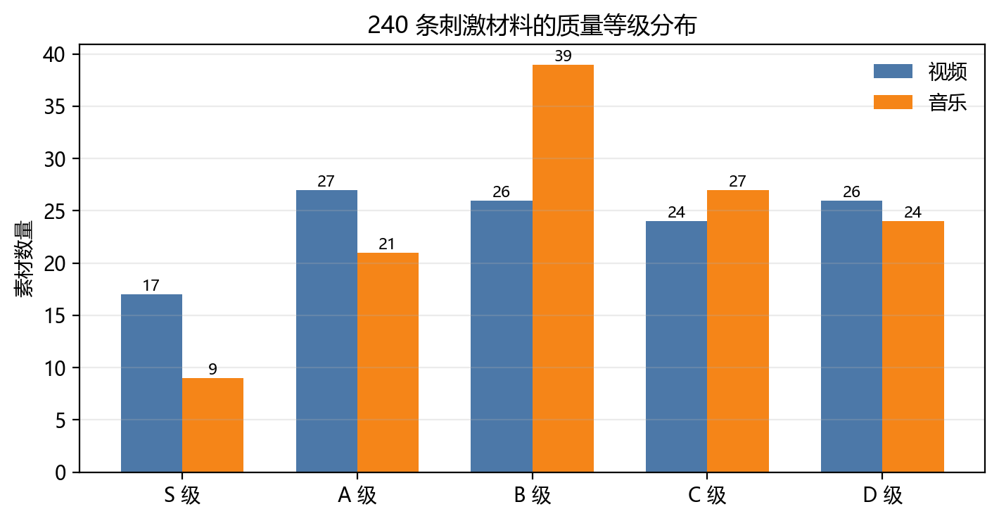

# 数据审计报告

**项目**：EEG-EmoStudio 脑电情绪识别数据制备与模型训练工作台  
**文档编号**：05  
**版本**：V1.0  
**审计日期**：2026-11-07  
**审计对象**：`山科数据集/`、`research/quality/video/`、`research/quality/audio/`  
**审计工具**：`python -m eeg_emostudio audit`、OpenCV（视频时长）、PyAV（音频时长）、pandas/openpyxl  
**证据目录**：`artifacts/audit/`、`artifacts/audit_probe/`

---

## 1. 审计结论（先看这里）

### 1.1 可用资产

- 视频刺激 **120 段**、音乐刺激 **120 首**，四象限各 **30**，物理文件齐全；
- 视频预评价 **1,269 条**、音乐预评价 **1,087 条**，共 **2,356 条**；
- 去重后视频 **1,227 条**、音乐 **1,072 条**；
- 两套质量排序各 **120 条**，含分数、等级、置信区间与稳健性检验；
- 可支撑“材料筛选 + 问卷清洗 + 质量门控 + 平衡选材”的完整数据制备链。

### 1.2 关键缺口

1. **自采原始 EEG 尚未进入工作区**；但 **SEED-IV 官方特征已接入**（15 被试 × 3 sessions × 24 trials，37,575 个 4 s 窗口），真实 LOSO 基线已跑通。自采数据的通道/采样率/事件/伪迹门禁仍需执行。
2. **音乐片段长度不统一**：26/120 条偏离 60±15 s，最短 23 s、最长 167 s。若实验程序按 60 s 播放，会与预评价时的实际片段不一致。
3. **素材表与映射表的标签不一致**：素材表 116/121 条“预期连续情绪”为空，离散标签使用“温馨/治愈/舒缓”等与映射表四象限/5 类体系不完全对齐；应明确**以哪张表为权威**。
4. **播放问题集中在少数文件**：视频 22 条、音乐 29 条有问题报告；音乐损坏/无法播放高度集中于同一批文件，需人工复检或替换。
5. **路径与版本不可移植**：映射表保留 `D:\desktop\workspace\...` 旧路径，未记录文件哈希；换机后无法自动校验同一文件。

### 1.3 2026-11-08 更新：SEED-IV 已接入

| 项目 | 结果 |
|---|---|
| 被试 / session / trial | 15 / 3 / 1,080 |
| 通道 / 频带 | 62 / 5 |
| 特征窗口 | 37,575（每 trial 10–64 个 4 s 窗） |
| 类别 trial 数 | 平静/悲伤/恐惧/快乐 = 270 / 270 / 270 / 270 |
| 类别窗口数 | 10,170 / 10,245 / 9,225 / 7,935 |
| 文件完整性 | 45 个特征 MAT 全部存在，无 NaN/Inf |
| 真实 LOSO（trial 级） | MLP Accuracy 42.78%、Macro-F1 0.4291、κ 0.237；DualView 27.69%（未调参） |

> 详细数据清单、适配器与结果见 `16_SEED_IV数据接入报告`。当前“真实 EEG”指 SEED-IV 官方预计算特征；自采原始 EEG 的预处理复现仍未执行。

### 1.4 关键数字

| 指标 | 视频 | 音乐 |
|---|---:|---:|
| 原始问卷 | 1,269 | 1,087 |
| 去重后 | 1,227 | 1,072 |
| 重复提交 | 42 | 15 |
| 评分者（规范化后） | 11 | 9 |
| 刺激数 | 120 | 120 |
| 编号写法 | 146 | 129 |
| 文字锚点（效价/唤醒） | 261 / 201 | 105 / 167 |
| 直线作答者 | 无 | 刘佳悦 |
| 问题刺激数 | 22 | 29 |
| 质量分范围 | 27.0–95.3 | 9.7–89.1 |
| 质量分中位 | 78.1 | 62.8 |

---

## 2. 审计范围与方法

### 2.1 范围

| 数据 | 检查项 |
|---|---|
| 问卷 CSV | 字段可识别、编码、缺失、编号、评分、文本锚点、重复、评分者、问题文本 |
| 映射 CSV | 行数、唯一性、类别、文件名、路径、时间字段 |
| 媒体文件 | 存在性、数量、时长（可选探测）、读取错误 |
| 素材表 XLSX | 行数、示例行、字段、标签一致性 |
| 质量排序 CSV | 行数、分数、等级、类别、重复、缺失 |
| EEG | 是否存在、格式、通道、采样率、事件（当前未执行） |

### 2.2 方法

1. **自动审计**：`eeg_emostudio.audit` 读取原始文件，按固定规则清洗，输出 JSON/CSV/Markdown。
2. **交叉核对**：把自动审计的重复数、问题刺激数、等级分布与既有质量报告比对。
3. **媒体探测**：OpenCV 读取视频帧率/帧数；PyAV 读取音频容器时长。探测仅用于发现异常，不替代人工播放检查。
4. **人工复核建议**：对所有 S1/S2 问题给出责任人、动作与截止时间。

### 2.3 可复现命令

```powershell
python -m eeg_emostudio audit --workspace . --out artifacts/audit
python -m eeg_emostudio audit --workspace . --out artifacts/audit_probe --probe-media
```

`artifacts/audit/audit_summary.json` 是机器可读的完整结果；`audit_report.md` 是摘要。

---

## 3. 数据资产清单

### 3.1 刺激与映射

| 项目 | 视频 | 音乐 |
|---|---|---|
| 物理文件 | 120 个 MP4 | 120 个 MP3 |
| 映射行数 | 120 | 120 |
| 类别分布 | HVHA/HVLA/LVHA/LVLA = 30/30/30/30 | 同左 |
| 缺失文件 | 0 | 0 |
| 多余文件 | 0 | 0 |
| 重复文件名 | 0 | 0 |
| 分辨率/格式 | 1080P，30 fps | MP3，采样率不一 |
| 实测时长 | 114.0–296.8 s，中位 186.3 s | 99.2–529.3 s，中位 249.6 s（119 个可读） |
| 标注片段 | 无起止字段 | 23–167 s，中位 60 s |

> 视频时长均在 2–5 min 目标范围内（114 s 略低于 2 min，需确认是否可接受）。音乐文件本身是完整歌曲，映射表的起止时间是“应播放片段”，不是文件时长。

### 3.2 问卷

| 项目 | 视频 | 音乐 |
|---|---|---|
| 文件 | `374437060_..._1271_1269(Sheet1).csv` | `376653806_..._1088_1087(Sheet1).csv` |
| 原始行数 | 1,269 | 1,087 |
| 列数 | 19 | 19 |
| 提交时间跨度 | 2026-08-10 起 | 2026-08-10 起 |
| 评分者 | 12 个原始姓名 → 11 个规范化 ID | 9 |
| 刺激 ID | 146 种写法 → 120 | 129 种写法 → 120 |
| 缺失值 | `来源详情` 507 条；业务字段 0 | `来源详情` 575 条；业务字段 0 |
| 重复（同评分者×刺激） | 42 | 15 |
| 直线作答 | 无 | 刘佳悦（效价 SD 0.74、唤醒 SD 0.62） |
| 部分完成 | 刘文杰 119、赵洪运 119、赵瀚 30 | 7 人 119–122，刘佳沂 119 |

### 3.3 质量排序

| 项目 | 视频 | 音乐 |
|---|---|---|
| 行数 | 120 | 120 |
| 分数范围 | 27.0–95.3 | 9.7–89.1 |
| 中位 | 78.1 | 62.8 |
| S/A/B/C/D | 17/27/26/24/26 | 9/21/39/27/24 |
| 四类均分 | HVHA 77.9、HVLA 70.7、LVHA 77.4、LVLA 72.8 | HVHA 79.7、HVLA 42.8、LVHA 58.7、LVLA 52.2 |
| 标签命中率 | 76%/51%/83%/56% | 84%/17%/38%/59% |

**解读**：

- 视频四类质量较均衡，适合作为主实验材料；
- 音乐 HVHA 明显最好，HVLA 最弱（平均 42.8，命中率 17%），如果四类等量选材，HVLA 只能选到 B 级；
- 音乐 29 条问题文件中 12 条“损坏/无法播放”，集中在少数评分者报告的同一批文件，提示文件本身兼容性问题。

---

## 4. 数据质量问题清单

> 严重度：S1 阻断（不修复不能用于正式实验/论文）；S2 重要（影响分析，需处理）；S3 一般（记录/改进）。

| ID | 问题 | 证据 | 严重度 | 影响 | 处理建议 | 责任 |
|---|---|---|---|---|---|---|
| DQ-01 | 自采原始 EEG 未接入 | 工作区已有 SEED-IV 官方特征；自采设备数据为空 | S1 | 无法验证自采数据的真实性能 | 保留 SEED-IV 作为外部验证；尽快导入自采数据 | 课题组 |
| DQ-02 | 音乐片段长度不一致 | 26/120 超出 60±15 s，23–167 s | S1 | 预评价与正式实验刺激不一致 | 统一截 60 s，或修订协议并重评 | 实验员 |
| DQ-03 | 素材表与映射表标签体系不一致 | 素材表 116 条连续标签缺失；离散用“温馨/治愈/舒缓”等 | S1 | 可能把不同标签混用 | 明确映射表为权威；素材表只作参考 | 数据管理员 |
| DQ-04 | 旧绝对路径 | `原始路径` 指向 `D:\desktop\workspace\...` | S2 | 换机不可用 | 改为相对路径 + 哈希 | 数据管理员 |
| DQ-05 | 重复提交 | 视频 42、音乐 15 | S2 | 放大个别评分者权重 | 已按首次提交去重 | 系统 |
| DQ-06 | 编号写法混乱 | 146/129 种写法；`388.mp4` 误写 | S2 | 关联失败/错配 | 显式别名 + 正则归一 + 审计 | 系统 |
| DQ-07 | 评分文字锚点 | 视频 261/201、音乐 105/167 条 | S2 | 不能直接数值计算 | 映射为 1/9 | 系统 |
| DQ-08 | 播放问题文本多选 | 36/78 条含问题；`┋` 分隔、含“没有问题”矛盾 | S2 | 质量分偏差 | 严重度并集 + 矛盾标记 | 系统 |
| DQ-09 | 视频播放问题 | 22 条（模糊/杂音/卡顿/加速等） | S2 | 情绪诱发失败 | 抽帧/试听复核；D 级替换 | 实验员 |
| DQ-10 | 音乐文件问题 | 29 条（损坏/音质/音量等），12 条损坏 | S2 | 无法播放/体验差 | 转码/替换/剔除 | 实验员 |
| DQ-11 | 直线作答 | 刘佳悦效价/唤醒 SD <1 | S2 | 拉低一致性 | 剔除或敏感性分析 | 系统 |
| DQ-12 | 部分评分者 | 赵瀚仅 30 条；多人 119–122 | S2 | 样本充分性不足 | 保留但计入 N；敏感性分析 | 数据管理员 |
| DQ-13 | 素材表含“示例”行 | 视频/音乐各 121 行 | S3 | 统计多 1 行 | 读取时排除 | 系统 |
| DQ-14 | 英文名/来源详情缺失 | 视频英文名 1 条缺失；来源详情 507/575 | S3 | 不影响分析 | 记录，不阻断 | 数据管理员 |
| DQ-15 | 音乐 118.mp3 元数据读取异常 | PyAV UnicodeDecodeError | S3 | 时长未知 | 人工播放/转码后复测 | 实验员 |
| DQ-16 | 无文件哈希 | 映射表只有路径 | S2 | 无法证明版本一致 | 首次入库计算 SHA-256 | 系统 |

### 4.1 问题分布

**视频播放问题（22 条）**：画面模糊 12、杂音 6、卡顿 2、音画不同步 1、加速 2、内容难以理解 2、音量 4（同一视频可多选）。

**音乐播放问题（29 条）**：损坏/无法播放 12、音质差 9、音量 4、卡顿/内容/其他若干。

**评分者问题**：

- 视频：无直线作答；赵瀚仅 30 条（29 条有效 + 1 条），保留并在 N 分中扣减；
- 音乐：刘佳悦直线作答，质量报告已剔除；剔除前后 Spearman 相关 0.995，排序稳健。

### 4.2 交叉验证

| 检查 | 自动审计 | 既有质量报告 | 结论 |
|---|---:|---:|---|
| 视频重复提交 | 42 | 42 | 一致 |
| 音乐重复提交 | 15 | 15 | 一致 |
| 视频问题刺激 | 22 | 22 | 一致 |
| 音乐问题刺激 | 29 | 29 | 一致 |
| 视频等级分布 | 17/27/26/24/26 | 17/27/26/24/26 | 一致 |
| 音乐等级分布 | 9/21/39/27/24 | 9/21/39/27/24 | 一致 |

> 这说明新系统的清洗/问题解析与既有生产脚本语义一致，可作为后续数据治理的可信入口。

---

## 5. 质量等级与材料可用性



### 5.1 解读

- 视频整体质量高于音乐（中位 78.1 vs 62.8）；
- 音乐“双峰”明显：无播放问题的歌曲集中在 49–89 分，有问题的被门控压到 10–55 分；
- 音乐 HVLA 平均仅 42.8，标签命中率 17%，说明这批“高效价-低唤醒”音乐没有达到预期诱发方向；
- 视频 HVLA/LVLA 的 S/A 数量较少，选 10 条/类时会用到 B 级，这是可接受的折中，但论文需说明。

### 5.2 对实验设计的影响

1. 若要求四类等量，音乐 HVLA 需要补材料或放宽到 B 级；
2. 若只追求高质量，会导致 HVHA 过度代表，不能直接取总榜前 N；
3. 建议正式实验采用“每模态每象限 10 条”的 80 条集合，并在论文附录列出 ID、分数、等级；
4. 所有 C/D 级材料不进入正式实验，除非研究问题明确需要“低质量对照”。

---

## 6. 平衡选材示例（80 条）

### 6.1 规则

- 模态内按四象限分层；
- 等级 S→A→B→C→D，同等级按质量分降序；
- 每层取 10 条；
- 不跨象限比较；
- 输出选择理由，便于复核。

### 6.2 结果

| 模态/象限 | 数量 | 平均分 | 最低等级 | 等级构成 |
|---|---:|---:|---|---|
| 视频/HVHA | 10 | 93.4 | A | S×8, A×2 |
| 视频/HVLA | 10 | 87.0 | B | S×1, A×5, B×4 |
| 视频/LVHA | 10 | 93.0 | A | S×7, A×3 |
| 视频/LVLA | 10 | 86.0 | B | S×1, A×5, B×4 |
| 音乐/HVHA | 10 | 86.4 | A | S×9, A×1 |
| 音乐/HVLA | 10 | 67.4 | B | A×1, B×9 |
| 音乐/LVHA | 10 | 70.8 | B | A×2, B×8 |
| 音乐/LVLA | 10 | 72.4 | B | A×3, B×7 |

**合计**：80 条；S 26、A 22、B 32、C/D 0。

### 6.3 使用建议

- 视频集合质量较高，可作为主实验；
- 音乐 HVLA/LVHA/LVLA 多为 B 级，建议先做 5–10 人预实验验证诱发效果；
- 若预实验发现某类失败，优先替换该类的 B 级材料，而不是降低整体标准；
- 具体 ID 清单见 `artifacts/selection/selected_materials.csv`。

---

## 7. EEG 数据审计（SEED-IV 已部分执行）

### 7.1 当前状态

截至 2026-11-08：

- **已接入**：`data/SEED_IV/eeg_feature_smooth` 的 45 个官方特征 MAT（15 被试 × 3 sessions），以及 `eeg_raw_data` 的 45 个原始 MAT；
- **已审计**：官方特征的 trial 数、通道、频带、窗口范围、类别平衡、NaN/Inf、文件完整性；
- **未执行**：自采 EEG 的阻抗、事件对齐、工频噪声、ICA/伪迹、原始 200 Hz 到 DE 的复现。

### 7.2 SEED-IV 特征审计

| 检查项 | 目标 | 状态 |
|---|---|---|
| 被试/会话/trial | 15 / 3 / 1,080 | 通过 |
| 通道 | 62，顺序与 Channel Order 一致 | 通过 |
| 频带 | 5（δ/θ/α/β/γ） | 通过 |
| 每 trial 窗口 | 10–64 个 4 s 窗 | 通过 |
| 标签 | 每 session 24 个，四类各 6 个 | 通过 |
| 类别平衡 | 每类 270 trial | 通过 |
| 数值 | 无 NaN/Inf | 通过 |
| 原始数据 | 45 个 MAT 文件存在 | 通过（未重跑预处理） |
| 眼动 | 45 个特征 MAT 存在 | 通过（未接入模型） |

### 7.3 自采 EEG 的验收门禁

自采数据仍需通过以下门禁；SEED-IV 的通过不代表自采设备数据通过：

| 门禁 | 条件 | 不通过处理 |
|---|---|---|
| QG-EEG-1 | 通道/采样率/单位与设备记录一致 | 重新导出 |
| QG-EEG-2 | 事件数与刺激数一致，偏移 ≤1 采样点 | 校准/重采 |
| QG-EEG-3 | 平直/饱和/工频/伪迹比例在阈值内 | 剔除/修复 |
| QG-EEG-4 | 每个被试每类 ≥20 个可用 Trial | 补采/降级 |
| QG-EEG-5 | 自评完整率 ≥95% | 补问/剔除 |
| QG-EEG-6 | 被试/会话/Trial 可唯一关联 | 修元数据 |

> SEED-IV 官方特征可以作为外部验证与工程回归；论文中不得把“自采数据性能”与 SEED-IV 结果混写。

---

## 8. 数据治理行动清单

| 优先级 | 行动 | 截止 | 验收 |
|---|---|---|---|
| P0 | 统一音乐片段为 60 s（或修订协议） | W5 | 120 条片段长度在 60±1 s |
| P0 | 确认标签权威表（映射表 vs 素材表） | W4 | 数据字典签字 |
| P0 | 导入首批自采 EEG 并跑 QG-EEG-1~6 | W6 | 审计报告更新 |
| P1 | 替换/修复 22 视频 + 29 音乐问题文件 | W6 | 问题清单清零或标注 |
| P1 | 计算全部媒体 SHA-256 | W5 | 映射表新增 hash 列 |
| P1 | 把旧绝对路径改为相对路径 | W5 | 换机可复现 |
| P2 | 补全英文名/来源/版权字段 | W8 | 缺失率 <1% |
| P2 | 为素材表增加“版本/日期/负责人” | W8 | 变更可追溯 |

---

## 9. 附录

### 9.1 输出文件

| 文件 | 内容 |
|---|---|
| `audit_summary.json` | 全部机器可读结果 |
| `audit_report.md` | 摘要报告 |
| `video_ratings_clean.csv` / `audio_ratings_clean.csv` | 清洗后逐条评分 |
| `video_rater_table.csv` / `audio_rater_table.csv` | 评分者统计 |
| `video_stimulus_coverage.csv` / `audio_stimulus_coverage.csv` | 每条刺激的评分覆盖 |
| `video_playback_issues.csv` / `audio_playback_issues.csv` | 播放问题明细 |
| `quality_combined.csv` | 240 条质量合并表 |
| `selected_materials.csv` | 80 条选材清单（在 `artifacts/selection/`） |
| `EEG-EmoStudio_数据审计工作簿.xlsx` | 可筛选的审计附件（`deliverables/`），含 10 个工作表与等级图表 |

### 9.2 字段口径

详见 `08_数据字典与数据治理规范`。本报告中的“有效评分”指通过编号/评分解析且未被直线作答规则剔除的记录；“问题刺激”指至少一条有效记录报告播放问题的刺激。

### 9.3 审计限制

- 未做人工逐条播放核验；
- 未核验媒体版权；
- 未核验评分者身份与重复参与；
- 未核验问卷链接的发放过程；
- 未读取 EEG（不存在）；
- 质量分沿用既有脚本结果，未在本报告内重算全部权重敏感性。

这些限制不影响“现有数据可用于选材与流程验证”的结论，但影响“可直接进入正式实验”的程度，需在 W5 前补齐。
