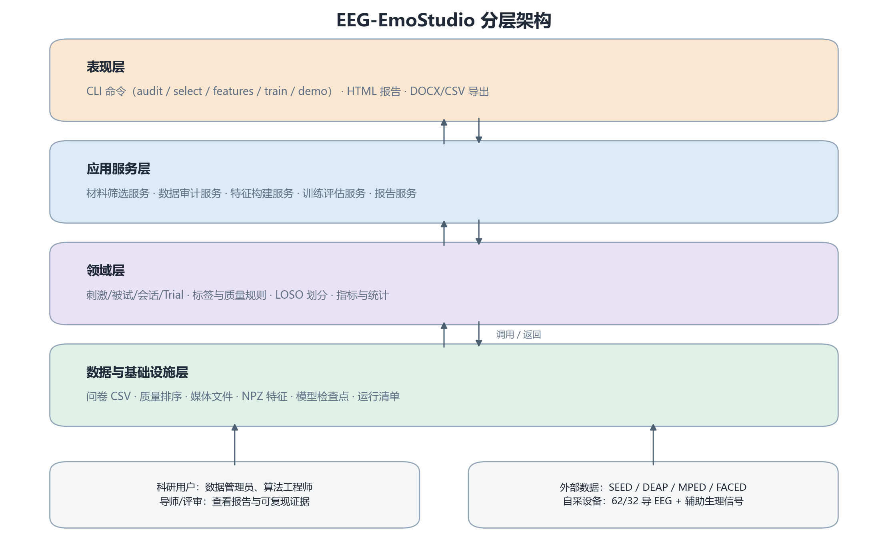
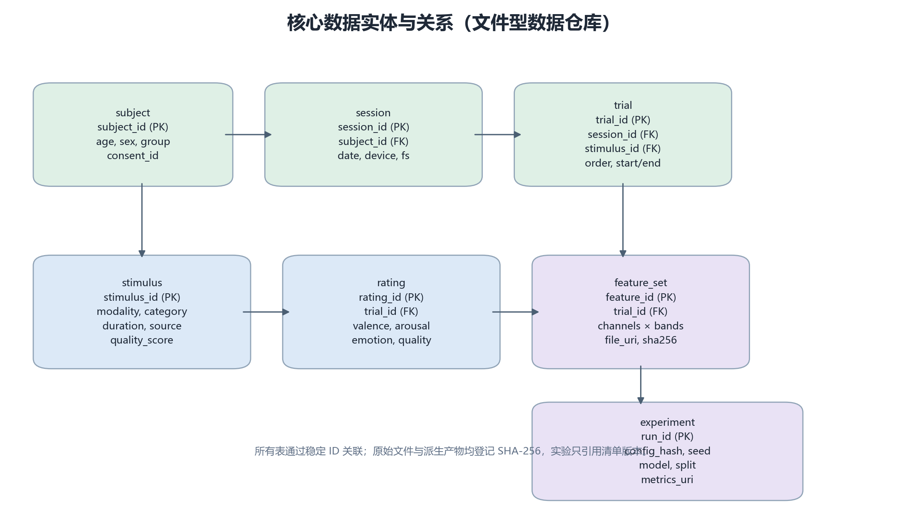
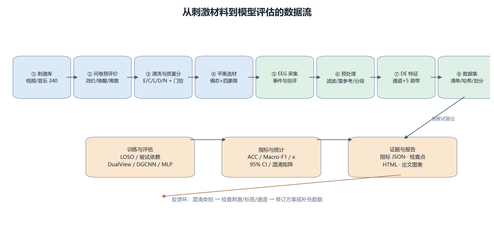

# 概要设计说明书

**项目**：EEG-EmoStudio 脑电情绪识别数据制备与模型训练工作台  
**文档编号**：06  
**版本**：V1.0  
**日期**：2026-11-07  
**上游**：[02] 软件需求规格说明书  
**下游**：[07] 详细设计说明书

---

## 1. 设计目标与原则

### 1.1 目标

把“数据制备”和“模型训练”做成一条可审计、可复现、可扩展的流水线，使研究者能够：

1. 用一条命令复核现有数据质量；
2. 用一条命令生成平衡的实验材料清单；
3. 用统一契约接入自采/公开 EEG；
4. 用固定划分和种子训练、评估、导出论文图表；
5. 在任何一台机器上复现同一结果。

### 1.2 设计原则

| 原则 | 落地方式 |
|---|---|
| 数据不可变 | 原始数据只读；派生数据写入新目录；哈希登记 |
| 关注点分离 | 审计、特征、模型、训练、报告各自独立 |
| 契约优先 | `raw.npz` / `features.npz` / manifest 明确字段 |
| 防泄漏 | 划分与标准化在训练折内拟合；断言被试隔离 |
| 可解释 | 指标、混淆矩阵、逐折/分被试结果全部保留 |
| 可扩展 | 新增数据集只写适配器；新增模型只注册工厂 |
| 轻依赖 | 核心仅 NumPy/SciPy/pandas/PyTorch；MNE 可选 |
| 证据化 | 每次运行输出配置、环境、数据哈希、日志 |

---

## 2. 系统架构



### 2.1 分层

| 层 | 职责 | 主要模块 |
|---|---|---|
| 表现层 | CLI、HTML 报告、DOCX/CSV 导出 | `cli.py`、`reporting/` |
| 应用服务层 | 编排用例：审计、选材、特征、训练、报告 | `audit/runner.py`、`pipeline.py`、`training/trainer.py` |
| 领域层 | 数据实体、规则、划分、指标、模型 | `audit/normalize.py`、`data/`、`models/`、`training/metrics.py` |
| 数据与基础设施层 | 文件、NPZ、JSON、媒体、检查点 | `data/manifest.py`、`reporting/figures.py` |

### 2.2 模块分解

```text
eeg_emostudio/
├── cli.py                  # 参数解析、用例编排、返回码
├── audit/
│   ├── normalize.py        # 编号/姓名/评分/时间/问题文本归一
│   ├── survey.py           # 问卷字段识别、清洗、评分者诊断
│   ├── media.py            # 映射、文件存在性、时长探测、素材表审计
│   ├── quality.py          # 质量表读取、合并、分层选材
│   └── runner.py            # 工作区级审计编排与 Markdown 报告
├── data/
│   ├── preprocess.py       # 滤波/陷波/重参考/重采样/分段/剔除
│   ├── features.py         # 5 频带 DE、PSD、聚合、标准化
│   ├── splits.py           # LOSO/被试依赖划分、泄漏断言
│   └── manifest.py         # NPZ 读写、SHA-256、manifest
├── models/
│   ├── mlp.py              # 特征基线
│   ├── dgcnn.py            # 动态图基线
│   ├── dualview.py         # 双视角多原型（提出方法）
│   ├── eegnet.py           # 原始波形基线
│   └── registry.py         # 模型工厂
├── training/
│   ├── metrics.py          # ACC/BA/Macro-F1/κ/CI/混淆矩阵
│   └── trainer.py          # 标准化、训练、早停、LOSO、检查点
├── reporting/
│   ├── figures.py          # 混淆矩阵、分被试柱状图
│   └── html.py             # 自包含 HTML 报告
├── demo.py                 # 合成特征/原始波形
└── pipeline.py             # raw.npz → features.npz
```

### 2.3 Web 控制台（V0.2）

```text
webapp/
├── main.py          # FastAPI 页面路由 + JSON API + 文件下载
├── services.py      # 只读数据服务（复用 CLI 产物）
├── jobs.py          # 线程池任务与状态/日志
├── tasks.py         # 调用 CLI 子进程
├── templates/       # Jinja2 页面
└── static/          # 设计系统 CSS、原生 JS、SVG 图表
```

Web 层不复制算法：审计/选材/特征/训练均调用现有 CLI，保证页面与论文命令一致。详细设计见 [15]。

### 2.4 依赖方向

```text
cli → audit/runner, pipeline, training, reporting
training → data (manifest/splits), models, metrics
models → torch only
data → numpy/scipy/pandas
audit → pandas/numpy, optional cv2/av
reporting → matplotlib
```

**规则**：`models` 不依赖 `audit`；`data` 不依赖 `training`；`reporting` 不反向调用训练。避免循环依赖。

---

## 3. 运行时视图

### 3.1 数据审计

```text
CLI audit
  → runner.run_workspace_audit
    → survey.load_survey(video/audio)
      → normalize.*
      → 清洗/去重/诊断
    → media.audit_media(mapping, media_dir)
      → 可选 probe
    → quality.load_quality_table
    → 写 CSV/JSON/Markdown
```

### 3.2 特征构建

```text
CLI features --raw raw.npz --out features.npz
  → pipeline.build_features_from_raw
    → 读取/校验 x,y,subjects,fs
    → preprocess.preprocess_array
    → features.compute_de_features
    → features.aggregate_windows
    → manifest.write_feature_dataset
    → 写 build.json
```

### 3.3 训练评估

```text
CLI train --data features.npz --setting loso
  → manifest.load_features
  → splits.loso_splits
  → for fold:
      trainer._train_fold
        → 训练折标准化
        → 模型工厂
        → CE(+原型正则)
        → 验证早停
      predict(test)
      metrics.compute_metrics
  → OOF 汇总 + bootstrap CI
  → 图 + HTML + checkpoints
```

### 3.4 时序约束

- 审计：无状态，可重复执行；
- 特征：同一输入+参数应输出相同结果（浮点环境一致时）；
- 训练：固定种子，CPU 下可复现；GPU 需开启 deterministic；
- 报告：只读取指标，不重新训练。

---

## 4. 数据架构

### 4.1 存储布局

```text
data/
├── raw/                    # 原始 EEG（只读；SEED-IV 原始 MAT 在 data/SEED_IV/）
├── interim/                # 清洗中间结果
├── processed/              # features.npz + manifest
└── metadata/               # subjects/sessions/trials（V1.1）

artifacts/
├── audit/                  # 审计证据
├── selection/              # 选材清单
├── demo/                   # 合成演示
└── <experiment>/           # metrics.json, report.html, checkpoints/
```

### 4.2 数据实体



- `subject` 1—N `session` 1—N `trial` N—1 `stimulus`；
- `trial` 1—1 `rating`；
- `trial` 1—1 `feature_set`；
- `experiment` 引用 `feature_set` + `config` + `split`。

V1.0 以 NPZ 中的 `subjects`/`sessions` 和 CSV 清单承载；V1.1 可迁移到 SQLite，表结构不变。

### 4.3 数据流



### 4.4 版本策略

- 原始数据：文件名 + SHA-256 + 入库日期；
- 特征集：`features_v{major}.{minor}.npz` + manifest；
- 划分：`folds_v1.json` + 种子；
- 模型：`fold_XX_subject.pt` + 配置；
- 报告：`report_{run_id}.html`；
- 论文数字：只引用冻结版本的 manifest 哈希。

---

## 5. 接口设计

### 5.1 CLI

| 命令 | 作用 | 关键参数 | 返回码 |
|---|---|---|---|
| `audit` | 审计问卷/映射/质量 | `--workspace --out --probe-media` | 0/2 |
| `select` | 分层选材 | `--per-class --min-grade --modalities` | 0/2 |
| `features` | raw→DE | `--raw --out --fs --window --step` | 0/2 |
| `train` | 训练评估 | `--data --model --setting --epochs` | 0/2 |
| `demo` | 合成演示 | `--out --model --subjects` | 0 |

### 5.2 NPZ 契约

**raw.npz**

| 键 | 类型 | 形状 | 必填 | 说明 |
|---|---|---|---|---|
| `x` | float32 | (trials, channels, samples) | 是 | µV |
| `y` | int64 | (trials,) | 是 | 0-based |
| `subjects` | str | (trials,) | 是 | 伪匿名 |
| `fs` | scalar | () | 否 | 采样率 |
| `class_names` | str | (classes,) | 否 | 类别名 |

**features.npz**

| 键 | 类型 | 形状 | 必填 |
|---|---|---|---|
| `x` | float32 | (samples, channels, bands) | 是 |
| `y` | int64 | (samples,) | 是 |
| `subjects` | str | (samples,) | 是 |
| `sessions` | str | (samples,) | 否 |
| `class_names` | str | (classes,) | 否 |
| `feature_names` | str | (bands,) | 否 |

### 5.3 JSON

- `audit_summary.json`：审计全量；
- `features.manifest.json`：数据版本；
- `metrics.json`：实验指标；
- `demo_summary.json`：演示摘要；
- `run.json`（V1.1）：配置/环境/哈希。

### 5.4 HTML

自包含，无外部 CDN；图片 base64；中文；含免责声明。

---

## 6. 部署设计

### 6.1 单机部署

```text
项目根目录
  ├── Python 3.11+ 虚拟环境
  ├── 代码（本仓库）
  ├── 原始数据（只读）
  └── artifacts/（可写）
```

### 6.2 环境隔离

```powershell
python -m venv .venv
.\.venv\Scripts\Activate.ps1
pip install numpy scipy pandas matplotlib torch openpyxl
# 可选：pip install mne opencv-python av
```

V1.0 不提供 `requirements.txt` 锁定版本；定稿前应补充并测试。

### 6.3 备份

- 原始数据：3-2-1（3 份、2 种介质、1 份异地/离线）；
- 特征/模型：可重建，但保留冻结版本；
- 文档：Git + DOCX 导出；
- 每周校验哈希。

---

## 7. 关键设计决策

| 决策 | 选项 | 选择 | 理由 |
|---|---|---|---|
| 交互方式 | Web / CLI | CLI + 本地 Web | 单机、可脚本化、可演示 |
| 存储 | SQLite / 文件 | 文件 + JSON | 数据量小、易备份、评审可直接看 |
| 预处理 | MNE / SciPy | SciPy 核心 + MNE 可选 | 减少安装失败；核心可单测 |
| 特征 | 原始波形 / DE | DE 为主 | 与文献可比、CPU 友好 |
| 模型 | 端到端 / 特征模型 | 两者都有 | EEGNet 端到端；DualView 特征 |
| 评估 | 随机划分 / LOSO | LOSO 为主 | 回答跨被试问题 |
| 报告 | Notebook / HTML | HTML | 非技术用户可读、可归档 |
| 配置 | 硬编码 / YAML | CLI + 预留 YAML | 先可用，后扩展 |

---

## 8. 异常与日志

### 8.1 异常分类

| 类型 | 例子 | 处理 |
|---|---|---|
| 输入错误 | 文件缺失、字段缺失、形状不符 | 抛 `ValueError`/自定义异常，CLI 返回 2 |
| 数据错误 | NaN/Inf、标签越界、被试泄漏 | 拒绝并指出样本/折 |
| 环境错误 | CUDA 不可用、依赖缺失 | 明确提示，回退或退出 |
| 运行时错误 | 磁盘满、权限不足 | 保留已写产物，返回非 0 |
| 研究性警告 | 某类样本不足、某折退化 | 记录 warning，不阻断 |

### 8.2 日志

- CLI 摘要写 stdout；
- 详细错误写 stderr；
- V1.1 增加 `logs/run_{id}.log`（时间/级别/模块/上下文）；
- 不记录姓名、IP、联系方式。

---

## 9. 安全与隐私设计

- 被试 ID 伪匿名，映射表单独加密存放；
- 报告不渲染姓名；
- 原始数据目录权限最小化；
- 不把原始媒体/EEG 提交到公开仓库；
- 导出前运行“姓名扫描”（V1.1）；
- 伦理批件号、同意书版本写入 manifest。

---

## 10. 需求追溯

| 需求 | 设计章节 | 模块 |
|---|---|---|
| FR-02 | §2.2, §3.1 | `audit/media.py` |
| FR-03 | §3.1 | `audit/survey.py` |
| FR-05 | §3.1 | `audit/quality.py` |
| FR-07 | §3.2 | `data/preprocess.py` |
| FR-08 | §3.2 | `data/features.py` |
| FR-09 | §4.4 | `data/manifest.py` |
| FR-10 | §3.3 | `data/splits.py` |
| FR-11 | §3.3 | `models/`, `training/trainer.py` |
| FR-13 | §3.3 | `training/metrics.py` |
| FR-15 | §5.4 | `reporting/` |
| FR-16 | §5.1 | `cli.py` |
| FR-19 | §2.3 | `webapp/` |

---

## 11. 后续演进

1. **V1.1**：原生 EEG 适配器（MNE）、SQLite 元数据、YAML 配置、多用户权限；
2. **V1.2**：UDA（DANN/MMD/原型）、多模态（眼动/心电）、跨刺激迁移；
3. **V2.0**：多用户、权限、审计日志、模型注册表。

演进不得破坏 NPZ/manifest 契约；重大变更需版本号升级与迁移脚本。
