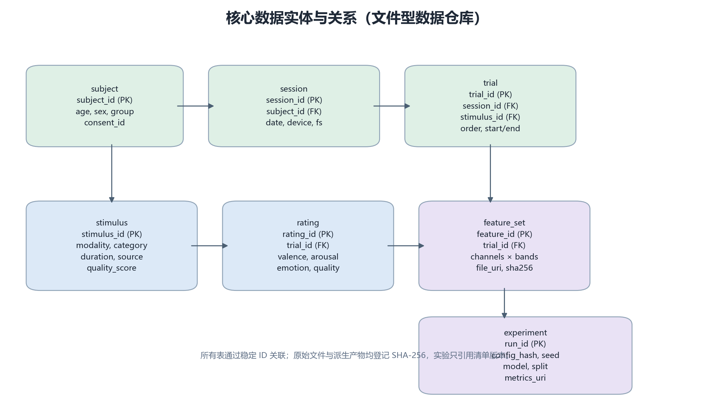

# 数据字典与数据治理规范

**项目**：EEG-EmoStudio 脑电情绪识别数据制备与模型训练工作台  
**文档编号**：08  
**版本**：V1.0  
**日期**：2026-11-07  
**适用范围**：刺激材料、预评价问卷、质量评分、EEG 元数据、特征、实验与报告

---

## 1. 数据治理原则

1. **单一事实源**：同一语义只允许一个权威字段；映射表是“材料—文件—四象限”的权威，素材表是“内容描述”的参考。
2. **原始不可变**：原始文件只读；所有清洗/派生写入新目录。
3. **可追溯**：每个派生文件记录源文件、参数、时间、SHA-256。
4. **最小必要**：只收集研究必需的被试信息；姓名/学号/联系方式不进入分析表。
5. **版本化**：标签体系、通道 montage、预处理参数、划分方案变更必须升版本。
6. **可复核**：任何人工修改必须记录“谁、何时、为什么、改了什么”。

---

## 2. 实体关系



```text
subject 1 ── N session 1 ── N trial N ── 1 stimulus
                                  │
                                  ├── 1 rating
                                  └── 1 feature_set
experiment N ── 1 feature_set
experiment N ── 1 split
```

V1.0 以文件/NPZ 承载；V1.1 可迁移到 SQLite，字段语义不变。

---

## 3. 刺激材料主表（stimulus）

**权威来源**：`山科数据集/视频对应关系.csv`、`音乐对应关系.csv`（材料—文件—四象限）；`素材列表.xlsx` 仅作内容描述参考。

| 字段 | 类型 | 必填 | 取值/规则 | 说明 |
|---|---|---|---|---|
| stimulus_id | string | 是 | `1.mp4`…`120.mp4` / `1.mp3`…`120.mp3` | 业务主键 |
| modality | enum | 是 | video / audio | 刺激类型 |
| category | enum | 是 | HVHA/HVLA/LVHA/LVLA | 四象限；权威 |
| original_id | int | 是 | 1–120 | 原始编号，不一定连续 |
| source_name | string | 是 | 自由文本 | 原始文件名 |
| title | string | 否 | 自由文本 | 作品名 |
| language | string | 否 | 中文/英文/纯音乐 | |
| subtitle | bool | 否 | 是/否 | |
| duration_s | float | 是 | >0 | 实际可播放时长 |
| segment_start_s | float | 音乐必填 | ≥0 | 应播放片段起点 |
| segment_end_s | float | 音乐必填 | >start | 应播放片段终点 |
| segment_s | float | 音乐派生 | end-start | 目标 60 s |
| file_path | string | 是 | 相对路径 | 禁止绝对路径 |
| sha256 | string | 是（V1.1） | 64 hex | 文件完整性 |
| copyright | string | 否 | 来源/授权 | 合规 |
| quality_score | float | 否 | 0–100 | 来自质量表 |
| quality_grade | enum | 否 | S/A/B/C/D | |
| status | enum | 是 | candidate/selected/rejected | 生命周期 |

**主键**：`(modality, stimulus_id)`。  
**唯一性**：同一模态内 `stimulus_id` 唯一；`file_path` 唯一。

---

## 4. 问卷原始表（survey_raw）

**来源**：问卷星 CSV，19 列，UTF-8 BOM。列名随问卷版本变化，系统按关键词识别。

| 原始列（示例） | 映射字段 | 类型 | 说明 |
|---|---|---|---|
| 序号 | row_id | int | 原始行号 |
| 提交答卷时间 | submitted_at | datetime | 用于排序/去重 |
| 所用时间 | duration_s | float | “2474秒” |
| 来源/来源详情 | source/source_detail | string | 分发渠道；可缺失 |
| 来自IP | ip | string | **不进入分析表** |
| 总分 | total_score | float | 问卷星自动分，不使用 |
| 1、您的姓名： | rater_raw | string | 需归一 |
| 2、视频编号/音乐歌曲编号 | stimulus_raw | string | 146/129 种写法 |
| 3、效价 | valence_raw | string | 数字或文字锚点 |
| 4、唤醒 | arousal_raw | string | 数字或文字锚点 |
| 5、明确度 | clarity | enum | 5 级 |
| 6、主导情绪 | emotion | enum | 5 类 + 无法判断 |
| 7、覆盖时长 | coverage | enum | 5 级 |
| 8、稳定性 | stability | enum | 4 级 |
| 9、熟悉度 | familiarity | enum | 4 级 |
| 10、理解度 | comprehension | enum | 视频正向/音乐负向 |
| 11、播放问题 | issues_raw | string | `┋` 多选 |
| 12、补充问题 | other_raw | string | `有，请说明〖...〗` |

**隐私字段**：`姓名`、`IP`、`来源详情` 不进入公开数据；分析表用 `rater_id` 替代。

---

## 5. 清洗后评分表（rating_clean）

**文件**：`artifacts/audit/{video,audio}_ratings_clean.csv`

| 字段 | 类型 | 允许空 | 说明 |
|---|---|---|---|
| row_id | int | 否 | 原始序号 |
| submitted_at | datetime | 否 | 提交时间 |
| duration_s | float | 是 | 作答秒数 |
| rater | string | 否 | 规范化姓名（内部）；对外用 rater_id |
| stimulus_raw | string | 否 | 原始编号 |
| stimulus_id | string | 否 | 归一后编号 |
| valence_raw | string | 否 | 原始效价 |
| arousal_raw | string | 否 | 原始唤醒 |
| valence | float | 否 | 1–9 |
| arousal | float | 否 | 1–9 |
| clarity | enum | 否 | 5 级 |
| emotion | enum | 否 | 5 类 + 无法判断 |
| coverage | enum | 否 | 5 级 |
| stability | enum | 否 | 4 级 |
| familiarity | enum | 否 | 4 级 |
| comprehension | enum | 否 | 5 级 |
| issues_raw | string | 否 | 原始多选 |
| issue_severity | float | 否 | 0–1 并集严重度 |
| issue_tags | string | 是 | `、` 连接 |
| issue_contradiction | bool | 否 | “没有问题”+具体问题 |
| other_raw | string | 否 | 原始补充 |
| other_issue_tag | string | 是 | 分类 |
| other_issue_text | string | 是 | 提取文本 |

**唯一键**：`(rater, stimulus_id)`。  
**取值域**：valence/arousal ∈ [1,9]；issue_severity ∈ [0,1]。

---

## 6. 评分者统计表（rater_table）

| 字段 | 类型 | 说明 |
|---|---|---|
| rater | string | 姓名（内部） |
| n_ratings | int | 去重后评分数 |
| valence_mean/arousal_mean | float | 均值 |
| valence_sd/arousal_sd | float | 标准差 |
| median_duration_s | float | 作答中位时长 |
| straightline_suspect | bool | 两个 SD 均 <1 |

**判定**：`straightline_suspect=true` 不等于一定剔除；需结合质量报告与敏感性分析。

---

## 7. 质量评分表（quality）

**文件**：`视频质量排序.csv` / `音乐歌曲质量排序.csv`

| 字段 | 类型 | 说明 |
|---|---|---|
| 排名 | int | 总排名 |
| 视频编号/音乐歌曲编号 | string | stimulus_id |
| 质量总分 | float | 0–100 |
| 质量等级 | enum | S/A/B/C/D |
| 情感类别(四象限) | enum | HVHA/HVLA/LVHA/LVLA |
| 四象限内排名 | int | 类内排名 |
| 有效评分人数 | int | N 分依据 |
| 问题人数/问题报告率/问题指数 | int/float/float | 播放问题 |
| 基础分/播放门控 | float | Base/G |
| E/C/L/D/N | float | 分项 |
| 平均效价/平均唤醒 | float | 1–9 |
| 标签命中率 | float | 0–1 |
| 分数95%CI / 排名95%CI | string | 区间 |
| 离散标签/一致率 | string/float | 多数票 |
| 主要问题 | string | 问题类型 |

**口径**：`质量总分 = 基础分 × 播放门控`；`质量等级` 阈值见质量报告；质量分不是情绪分类标签。

---

## 8. 选材表（selected_materials）

| 字段 | 类型 | 说明 |
|---|---|---|
| modality | enum | video/audio |
| stimulus_id | string | 主键之一 |
| category | enum | 四象限 |
| quality_score | float | 质量总分 |
| grade | enum | S/A/B/C/D |
| rank | int | 总排名 |
| category_rank | int | 类内排名 |
| selection_rank | int | 选材顺序 |
| selection_reason | string | 理由 |
| n_raters | int | 有效人数 |
| problem_rate | float | 问题报告率 |
| main_issue | string | 主要问题 |
| discrete_label | string | 离散标签 |

**规则**：同一 `(modality, stimulus_id)` 只出现一次；四象限数量相等（除非告警）。

---

## 9. 原始 EEG 容器（raw.npz）

| 键 | 类型 | 形状 | 必填 | 单位/取值 |
|---|---|---|---|---|
| x | float32 | (trials, channels, samples) | 是 | µV |
| y | int64 | (trials,) | 是 | 0..K-1 |
| subjects | unicode | (trials,) | 是 | S01… |
| fs | scalar | () | 否 | Hz |
| class_names | unicode | (K,) | 否 | 中文/英文 |
| channel_names | unicode | (channels,) | 否 | 10-20 名称 |
| session_ids | unicode | (trials,) | 否 | 会话 |

**校验**：无 NaN/Inf；采样率 >0；标签非负；`trials` 一致。

---

## 10. 特征数据集（features.npz）

| 键 | 类型 | 形状 | 必填 | 说明 |
|---|---|---|---|---|
| x | float32 | (samples, channels, bands) | 是 | DE 或 PSD |
| y | int64 | (samples,) | 是 | 0..K-1 |
| subjects | unicode | (samples,) | 是 | 伪匿名 |
| sessions | unicode | (samples,) | 否 | 会话 |
| class_names | unicode | (K,) | 否 | |
| feature_names | unicode | (bands,) | 否 | delta…gamma |

**配套 manifest**：见 §11。

---

## 11. 数据集清单（manifest）

| 字段 | 类型 | 说明 |
|---|---|---|
| schema_version | string | 1.0 |
| feature_file | string | 相对路径 |
| sha256 | string | 特征文件哈希 |
| n_samples | int | 样本数 |
| n_channels | int | 通道数 |
| n_features | int | 频带/特征数 |
| n_subjects | int | 被试数 |
| n_classes | int | 类别数 |
| class_names | array | 类别名 |
| class_counts | object | 每类样本数 |
| subject_counts | object | 每被试样本数 |
| sessions | array | 会话列表 |
| generated_at | string | ISO 时间 |
| extra | object | 源文件/参数/备注 |

**规则**：manifest 与 NPZ 必须同名同目录；哈希变化即新版本。

---

## 12. 实验指标（metrics.json）

| 字段 | 类型 | 说明 |
|---|---|---|
| setting | string | loso / subject-dependent |
| model | string | mlp/dgcnn/dualview/eegnet |
| n_samples/n_subjects/n_classes | int | 规模 |
| folds | array | 每折指标/被试/样本数 |
| overall | object | OOF 总体指标 |
| per_subject | array | 分被试 |
| config | object | 超参/种子 |
| environment | object | Python/PyTorch/平台 |
| fold_description | array | 每折被试清单 |

**overall**：accuracy、balanced_accuracy、macro_f1、cohen_kappa、per_class、confusion_matrix、accuracy_ci95。

---

## 13. 编码与命名规范

### 13.1 标识符

- 被试：`S01`…`S99`（不入库姓名）；
- 会话：`S01_S1`；
- Trial：`S01_S1_T001`；
- 刺激：`V001`/`A001`（与文件名映射）；
- 实验：`{date}_{model}_{setting}_{seed}`。

### 13.2 缺失值

- CSV：空字符串；
- 数值：`NaN`（仅中间表）；
- 模型输入：禁止 NaN/Inf；
- 不得用 `0` 代替缺失（会污染均值）。

### 13.3 时间

- 统一秒（float）；
- 时区 Asia/Shanghai；
- 问卷时间保留原始字符串 + 解析后 ISO。

### 13.4 类别编码

| 任务 | 编码 |
|---|---|
| 四象限 | HVHA=0, HVLA=1, LVHA=2, LVLA=3 |
| 离散 5 类 | 悲伤/失落=0, 恐惧/不安=1, 温馨/放松=2, 激昂=3, 愉快=4 |
| 无法判断 | 不进入分类，单独统计 |

**编码顺序一旦用于论文，不得在中途改变。**

---

## 14. 数据生命周期

| 阶段 | 动作 | 责任人 | 保留 |
|---|---|---|---|
| 采集 | 原始文件+元数据+同意书 | 实验员 | 原始只读 |
| 入库 | 哈希、命名、备份 | 数据管理员 | 长期 |
| 清洗 | 生成 clean/audit | 系统 | 随论文 |
| 特征 | 生成 NPZ/manifest | 算法工程师 | 冻结版本 |
| 训练 | 检查点/指标 | 算法工程师 | 至答辩后 |
| 发表 | 聚合结果/图表 | 学生 | 长期 |
| 销毁 | 撤回/到期 | 数据管理员 | 按伦理要求 |

---

## 15. 隐私与合规

### 15.1 分级

| 级别 | 数据 | 访问 |
|---|---|---|
| L1 公开 | 聚合指标、代码、文档 | 公开 |
| L2 内部 | 去标识特征、质量表 | 课题组 |
| L3 敏感 | 原始 EEG、面部视频、姓名映射 | 负责人+授权 |
| L4 受控 | 知情同意书、伦理材料 | 导师/伦理委员会 |

### 15.2 规则

- 分析表不含姓名/IP/学号；
- 报告只显示伪 ID；
- 原始数据不提交 Git/公网；
- 传输加密；备份加密；
- 被试撤回：删除 L3/L4 中可识别部分，L2 标记不可用于新研究；
- 论文致谢/伦理声明写明批件号与同意版本。

### 15.3 版权

- 视频/音乐仅用于研究，不随论文/仓库分发；
- 公开数据集遵循原许可；
- 引用格式见 `04_文献综述`。

---

## 16. 质量门禁

| 门禁 | 对象 | 条件 | 不通过 |
|---|---|---|---|
| QG-1 | 刺激 | 120+120，四象限各 30，文件存在 | 阻断选材 |
| QG-2 | 问卷 | 字段可识别，重复可解释，评分 1–9 | 阻断质量评分 |
| QG-3 | 质量 | 120+120，分数/等级完整 | 阻断选材 |
| QG-4 | 选材 | 每层 N 条，无 C/D（默认） | 告警/调整 |
| QG-5 | 特征 | 形状正确，无 NaN/Inf，manifest 完整 | 阻断训练 |
| QG-6 | 划分 | 无被试泄漏，每样本留出一次 | 阻断训练 |
| QG-7 | 实验 | 配置/种子/环境/哈希齐全 | 阻断论文引用 |
| QG-8 | 报告 | 无姓名，合成数据标注 | 阻断发布 |

---

## 17. 变更记录

| 版本 | 日期 | 变更 | 影响 |
|---|---|---|---|
| V1.0 | 2026-11-07 | 建立字段字典、编码、门禁 | 基线 |

**变更流程**：提出 → 影响分析（字段/模型/论文）→ 导师确认 → 升版本 → 迁移脚本 → 回归测试。
