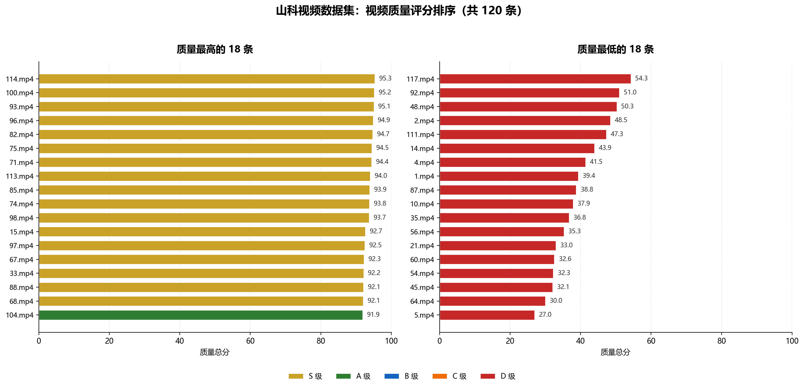

# 山科视频数据集：单条视频质量评分与排序报告

**输入数据**：`374437060_按文本_情绪诱发情况评估（视频）_1271_1269(Sheet1).csv`（1,269 条问卷记录）
**参考文件**：`视频对应关系.csv`（120 条视频的目标情感象限）
**评分对象**：120 条视频（已按视频编号去重）
**评分范围**：0–100 分，分数越高表示该片段作为情绪诱发素材的质量越好

---

## 摘要

1. **最终排序**见 `视频质量排序.csv` / `视频质量评分与排序.xlsx`。前 10 名为：114.mp4、100.mp4、93.mp4、96.mp4、82.mp4、75.mp4、71.mp4、113.mp4、85.mp4、74.mp4。
2. **等级分布**：S 级 17 条、A 级 27 条、B 级 26 条、C 级 24 条、D 级 26 条；中位分 78.1。视频整体质量明显高于音乐版（音乐中位 62.8）。
3. **第 11 题仍是主导因素**：22 条存在播放问题；只要有一条非“没有问题”的记录，先打 0.75 折，再按问题严重度与比例指数衰减。
4. **视频的类别效度很好**：HVHA/HVLA/LVHA/LVLA 四象限的平均效价/唤醒分别为 (7.2, 7.3)、(6.8, 4.2)、(2.7, 7.6)、(3.4, 4.5)，与目标象限高度吻合；离散标签也几乎一一对应（恐惧 29/30 在 LVHA、悲伤 30/31 在 LVLA、温馨 23/24 在 HVLA、激昂 21/21 在 HVHA）。
5. **问题类型集中在画面**：画面模糊 12 条、杂音 6 条、卡顿 2 条、音画不同步 1 条、视频加速 2 条、内容难以理解 2 条。部分模糊报告来自单一评分者，已在下文标注。
6. **两套标签都给了排序**：总表按四象限分组；`08_离散情绪排序` 按第 6 题的 5 类离散情绪分组，类内排序、跨类不比较。

---

## 一、数据清洗

| 步骤 | 处理 | 结果 |
|---|---|---|
| 原始记录 | 问卷星导出 | 1,269 条 |
| 编号归一 | 提取数字统一为 `N.mp4` | 146 种写法 → 120 条 |
| 误写修正 | `388.mp4` 还原为 `38.mp4` | 张涵博漏评 38、多写 388，修正后每人 120 条 |
| 重复提交 | 同一评分者×同一视频保留首次 | 删除 42 条，余 1,227 条 |
| 无效评分者 | 效价、唤醒组内 SD 均 < 1.0 | 未发现直线作答（最低效价 SD 2.1），无剔除 |
| 部分评分者 | 赵瀚仅完成 29 条 | 保留；剔除后排序相关 0.999 |
| 无效行 | 报告“损坏/无法播放/音画不同步/加速” | 不计入 E/C/L 聚合，仍计入播放门控 |

**量表编码**：效价“非常不愉快→非常愉快”记为 1–9；唤醒“非常平静→非常激烈”记为 1–9。

---

## 二、评分规则

### 2.1 总分结构（基础分 100 分）

| 维度 | 分值 | 构成 |
|---|---|---|
| **E 情绪诱发有效性** | 50 | 主导情绪明确度 Q5（16）+ 覆盖时长 Q7（12）+ 稳定性 Q8（9）+ 情绪可归类 Q6（8）+ 效价/唤醒强度（5） |
| **C 跨评分者一致性** | 20 | 20 × [0.5 × 主导情绪份额（扣除随机水平）+ 0.5 × 效价/唤醒离散度] |
| **L 情感标签效度** | 15 | 15 × [0.6 × 目标象限命中率 + 0.4 × 均值点与象限理想点接近度] |
| **D 干扰控制** | 10 | 10 ×（0.5 × 不熟悉程度 + 0.5 × 片段可理解度）；越不熟悉、片段越自洽得分越高 |
| **N 样本充分性** | 5 | 5 × min(1, 有效评分人数 / 10) |
| **Base** | 100 | E + C + L + D + N |

与音乐版的差异：第 10 题问的是“未看完整影视时能否理解该片段”，**理解度越高说明片段越自洽、越适合做独立刺激**，因此是正向计分（音乐版的歌词理解是负向，避免语义加工干扰）。

各题赋值：

- **Q5 明确度**：非常清晰 16 / 较清晰 12 / 能辨认但不明确 7 / 很模糊 3 / 没有明显情绪 0
- **Q7 覆盖时长**：>75% 12 / 50–75% 9 / 25–50% 5.5 / <25% 2 / 无法判断 0
- **Q8 稳定性**：全程稳定 9 / 有波动但主导不变 7 / 明显反转 3 / 无法判断 1
- **Q6 情绪**：能归入 5 类具体情绪 8 分；“无法判断”0 分
- **强度**：5 × min(1, (|效价−5|+|唤醒−5|)/4)
- **D**：熟悉度（从未 1.0 / 隐约 0.8 / 比较 0.5 / 非常 0.2）；片段理解（基本完全 1.0 → 完全无法 0.0）
- **L**：目标象限取自 `视频对应关系.csv`；命中率按每名评分者的效价、唤醒是否同时落在目标半区计算，并扣除 25% 随机水平

### 2.2 第 11 题：播放问题门控（权重最大）

| 问题类型 | 严重度 | 说明 |
|---|---|---|
| 文件损坏 / 无法播放 | 1.00 | 素材不可用 |
| 音画不同步 | 0.90 | 严重破坏观看体验 |
| 视频加速 / 倍速异常 | 0.90 | 节奏被改变，情绪诱发失真 |
| 画面模糊 / 画质差 | 0.80 | 直接影响观看与情绪 |
| 存在杂音 / 音频不清 | 0.65 | |
| 内容难以理解 | 0.60 | |
| 画面或声音播放卡顿 | 0.60 | |
| 声音过大或过小 | 0.55 | 可通过归一化修复 |
| 其他（无法归类） | 0.50 | |
| 勾选“没有问题”同时又写具体问题 | ×0.90 | 自相矛盾，弱化处理 |
| 第 12 题补充因素 | 0.4–0.7 | 加速 0.7、不同步 0.7、模糊 0.6、音频不清 0.55 |

单条视频问题指数 `w` = 全部去重记录严重度的均值。**播放门控**：

```
G = exp(−3.0 × w) × (w > 0 时再 × 0.75)      （下限 0.05）
最终得分 = Base × G
```

示例（10 名评分者）：

| 情形 | w | G | 相对损失 |
|---|---|---|---|
| 无问题 | 0 | 1.000 | 0% |
| 1/10 人报画面模糊 | 0.080 | 0.590 | 约 41% |
| 2/10 人报画面模糊 | 0.160 | 0.464 | 约 54% |
| 3/10 人报杂音 | 0.195 | 0.418 | 约 58% |
| 4/10 人报卡顿+杂音+模糊 | 0.274 | 0.330 | 约 67% |
| 半数人报损坏/无法播放 | 0.500 | 0.167 | 约 83% |

### 2.3 等级

视频分数整体偏高（多数片段诱发清晰），阈值按视频分布校准：

| 等级 | 分数 | 条数 | 建议 |
|---|---|---|---|
| S | ≥ 92 | 17 | 质量优秀，可直接进入正式实验 |
| A | 85–92 | 27 | 质量良好，优先使用 |
| B | 75–85 | 26 | 可用，次级备选 |
| C | 60–75 | 24 | 谨慎：个别播放问题或诱发偏弱 |
| D | < 60 | 26 | 不建议：播放问题或标签严重不符 |

### 2.4 离散情绪标签

第 6 题的 5 类主导情绪构成离散标签。规则：某类情绪被 **≥40%** 的有效评分者选择，且**严格多于第二名**、**多于“无法判断”**，才定为主标签；否则归入“混合/不明确”。类内按质量总分降序，跨类不比较。

---

## 三、结果

### 3.1 总分分布



分数呈“高分聚集 + 低分长尾”：多数视频在 70–95 分，22 条有播放问题的视频被压到 27–60 分。中位分 78.1，最高 95.3，最低 27.0。

各分项与总分的 Spearman 相关：E 0.64、C 0.56、L 0.56、D 0.07、问题指数 w -0.66。

### 3.2 前 20 名

| 排名 | 编号 | 得分 | 等级 | 类别 | 主要问题 |
|---|---|---|---|---|---|
| 1 | 114.mp4 | 95.3 | S | LVHA | 无 |
| 2 | 100.mp4 | 95.2 | S | LVHA | 无 |
| 3 | 93.mp4 | 95.1 | S | HVLA | 无 |
| 4 | 96.mp4 | 94.9 | S | HVHA | 无 |
| 5 | 82.mp4 | 94.7 | S | HVHA | 无 |
| 6 | 75.mp4 | 94.5 | S | HVHA | 无 |
| 7 | 71.mp4 | 94.4 | S | HVHA | 无 |
| 8 | 113.mp4 | 94.0 | S | HVHA | 无 |
| 9 | 85.mp4 | 93.9 | S | LVHA | 无 |
| 10 | 74.mp4 | 93.8 | S | LVHA | 无 |
| 11 | 98.mp4 | 93.7 | S | HVHA | 无 |
| 12 | 15.mp4 | 92.7 | S | LVHA | 无 |
| 13 | 97.mp4 | 92.5 | S | LVLA | 无 |
| 14 | 67.mp4 | 92.3 | S | HVHA | 无 |
| 15 | 33.mp4 | 92.2 | S | LVHA | 无 |
| 16 | 88.mp4 | 92.1 | S | HVHA | 无 |
| 17 | 68.mp4 | 92.1 | S | LVHA | 无 |
| 18 | 104.mp4 | 91.9 | A | LVLA | 无 |
| 19 | 120.mp4 | 91.9 | A | LVHA | 无 |
| 20 | 77.mp4 | 91.8 | A | LVHA | 无 |

前 20 名中 8 条为 HVHA，其余为 114.mp4（LVHA）、100.mp4（LVHA）、93.mp4（HVLA）、85.mp4（LVHA）、74.mp4（LVHA）、15.mp4（LVHA）、97.mp4（LVLA）、33.mp4（LVHA）、68.mp4（LVHA）、104.mp4（LVLA）、120.mp4（LVHA）、77.mp4（LVHA）。这些片段的共同点是：主导情绪非常清晰、覆盖 75% 以上、跨评分者标签高度一致（多数 C 接近 20 分），且没有播放问题。

### 3.3 后 15 名

| 排名 | 编号 | 得分 | 等级 | 类别 | 主要问题 | 有效人数 |
|---|---|---|---|---|---|---|
| 106 | 2.mp4 | 48.5 | D | HVHA | 模糊 | 10 |
| 107 | 111.mp4 | 47.3 | D | LVHA | 杂音 | 10 |
| 108 | 14.mp4 | 43.9 | D | HVLA | 无 | 10 |
| 109 | 4.mp4 | 41.5 | D | LVHA | 模糊 | 10 |
| 110 | 1.mp4 | 39.4 | D | HVLA | 模糊 | 11 |
| 111 | 87.mp4 | 38.8 | D | LVLA | 不同步、音量 | 10 |
| 112 | 10.mp4 | 37.9 | D | HVLA | 模糊 | 10 |
| 113 | 35.mp4 | 36.8 | D | HVHA | 模糊 | 10 |
| 114 | 56.mp4 | 35.3 | D | HVLA | 加速、杂音 | 9 |
| 115 | 21.mp4 | 33.0 | D | HVLA | 模糊 | 10 |
| 116 | 60.mp4 | 32.6 | D | LVHA | 杂音 | 10 |
| 117 | 54.mp4 | 32.3 | D | LVLA | 加速 | 10 |
| 118 | 45.mp4 | 32.1 | D | LVLA | 杂音、模糊、音量 | 10 |
| 119 | 64.mp4 | 30.0 | D | HVLA | 模糊 | 11 |
| 120 | 5.mp4 | 27.0 | D | HVHA | 卡顿、杂音、模糊 | 10 |

后段主要是画面模糊、杂音、卡顿、加速等问题视频；少数是情绪诱发本身偏弱（如 14.mp4 无播放问题，但 E 仅 19.8、基础分 43.9）。

### 3.4 问题最严重的 16 条（按得分从低到高）

| 排名 | 编号 | 得分 | 基础分 | 门控 | 问题人数 | 问题类型 |
|---|---|---|---|---|---|---|
| 120 | 5.mp4 | 27.0 | 79.3 | 0.3 | 4 | 卡顿、杂音、模糊 |
| 119 | 64.mp4 | 30.0 | 48.7 | 0.6 | 1 | 模糊 |
| 118 | 45.mp4 | 32.1 | 75.6 | 0.4 | 3 | 杂音、模糊、音量 |
| 117 | 54.mp4 | 32.3 | 53.1 | 0.6 | 1 | 加速 |
| 116 | 60.mp4 | 32.6 | 78.0 | 0.4 | 3 | 杂音 |
| 115 | 21.mp4 | 33.0 | 69.4 | 0.5 | 2 | 模糊 |
| 114 | 56.mp4 | 35.3 | 74.9 | 0.5 | 2 | 加速、杂音 |
| 113 | 35.mp4 | 36.8 | 77.3 | 0.5 | 2 | 模糊 |
| 112 | 10.mp4 | 37.9 | 81.7 | 0.5 | 2 | 模糊 |
| 111 | 87.mp4 | 38.8 | 76.8 | 0.5 | 2 | 不同步、音量 |
| 110 | 1.mp4 | 39.4 | 65.3 | 0.6 | 1 | 模糊 |
| 109 | 4.mp4 | 41.5 | 89.4 | 0.5 | 2 | 模糊 |
| 107 | 111.mp4 | 47.3 | 93.2 | 0.5 | 2 | 杂音 |
| 106 | 2.mp4 | 48.5 | 82.2 | 0.6 | 1 | 模糊 |
| 105 | 48.mp4 | 50.3 | 80.3 | 0.6 | 1 | 内容 |
| 103 | 117.mp4 | 54.3 | 95.1 | 0.6 | 1 | 模糊、音量 |

**问题分布**：画面模糊 12 条、杂音 6 条、卡顿 2 条、音画不同步 1 条、视频加速 2 条、内容难以理解 2 条、声音过大或过小 4 条。

需要人工复核的一点：画面模糊的报告部分集中在单一评分者（冯佳美 6 条，其中 1、103、112、117 只有她一人报告），不能排除是其播放设备或清晰度感知差异；这几条视频的分数因此偏低，建议抽帧复核后再决定是否弃用。杂音则有交叉印证（60 有 3 人、111 与 5 各有 2 人）。

### 3.5 四个情感类别

| 类别 | 条数 | 平均分 | 最高 | 最低 | 标签命中率 | 平均效价 | 平均唤醒 |
|---|---|---|---|---|---|---|---|
| HVHA | 30 | 77.9 | 94.9 | 27.0 | 76% | 7.2 | 7.3 |
| HVLA | 30 | 70.7 | 95.1 | 30.0 | 51% | 6.8 | 4.2 |
| LVHA | 30 | 77.4 | 95.3 | 32.6 | 83% | 2.7 | 7.6 |
| LVLA | 30 | 72.8 | 92.5 | 32.1 | 56% | 3.3 | 4.5 |

四类的平均分差距不大（70.7–77.9），没有音乐版那种“HVLA 明显失效”的问题。四类的平均效价/唤醒与目标象限高度一致，说明这批视频的标签效度整体较好。

### 3.6 按离散情绪类别排序

| 离散标签 | 条数 | 平均分 | S/A/B/C/D | 类内前 3 条（分数） |
|---|---|---|---|---|
| 悲伤/失落 | 31 | 72.9 | 1/5/8/13/4 | 97.mp4（92.5）、104.mp4（91.9）、107.mp4（89.8） |
| 恐惧/不安 | 30 | 78.1 | 7/11/2/2/8 | 114.mp4（95.3）、100.mp4（95.2）、85.mp4（93.9） |
| 温馨/放松 | 24 | 72.7 | 1/5/8/5/5 | 93.mp4（95.1）、99.mp4（90.6）、110.mp4（90.2） |
| 激昂 | 21 | 77.1 | 8/3/3/2/5 | 96.mp4（94.9）、82.mp4（94.7）、75.mp4（94.5） |
| 愉快 | 10 | 80.2 | 0/3/5/1/1 | 47.mp4（91.6）、108.mp4（91.4）、55.mp4（87.0） |
| 混合/不明确 | 4 | 49.7 | 0/0/0/1/3 | 86.mp4（73.9）、92.mp4（51.0）、14.mp4（43.9） |

要点：

- **离散标签与四象限几乎一一对应**：恐惧 29/30 在 LVHA、悲伤 30/31 在 LVLA、温馨 23/24 在 HVLA、激昂 21/21 在 HVHA；只有 4 条“混合/不明确”。这与音乐版形成鲜明对比（音乐 HVLA 命中率仅 17%）。
- **愉快** 10 条中 7 条在 HVHA、3 条在 HVLA，说明“愉快”在效价-唤醒平面上跨了两个象限，是四象限标签无法区分的一类。
- 如果实验用离散标签，直接用 `08_离散情绪排序` / `视频离散情绪分类排序.csv`；如果用连续标签，用 `07_类别内排序` 或总表。

### 3.7 稳健性

| 检验场景 | Spearman 秩相关 |
|---|---|
| 剔除部分评分者赵瀚 | 0.9987 |
| E权重+20% | 0.9720 |
| C权重+20% | 0.9798 |
| L权重+20% | 0.9801 |
| 门控k=2.0 | 0.9996 |
| 门控k=4.0 | 0.9999 |
| 不含标签效度L | 0.9639 |
| 不含干扰控制D | 0.9961 |

- 对 11 名评分者做 500 次 Bootstrap 重抽样，Top 10 的 95% 排名区间上限最远到第 29 名。
- 权重扰动 ±20%、门控强度 k=2/4、剔除部分评分者赵瀚、去掉 L 或 D，排序的 Spearman 相关均在 0.96 以上。

### 3.8 评分者核查

| 评分者 | 评分数 | 效价SD | 唤醒SD | 效价共识r | 唤醒共识r | 时间中位数(s) | 判定 |
|---|---|---|---|---|---|---|---|
| 赵瀚 | 29 | 2.2 | 2.3 | 0.8 | 0.7 | 110.0 | 部分评分 |
| 刘文杰 | 119 | 3.2 | 2.5 | 0.9 | 0.6 | 81.0 | 保留 |
| 赵洪运 | 119 | 3.7 | 3.5 | 0.8 | 0.8 | 61.0 | 保留 |
| 张涵博 | 120 | 2.1 | 2.0 | 0.9 | 0.8 | 312.5 | 保留 |
| 宋明臻 | 120 | 2.2 | 2.2 | 0.9 | 0.8 | 35.0 | 保留 |
| 张嘉文 | 120 | 2.4 | 2.5 | 0.4 | 0.8 | 103.5 | 保留 |
| 段凯峰 | 120 | 2.5 | 1.9 | 0.9 | 0.7 | 36.0 | 保留 |
| 王呈宇 | 120 | 2.5 | 2.2 | 0.8 | 0.8 | 51.5 | 保留 |
| 杨佳绮 | 120 | 2.5 | 2.2 | 0.9 | 0.8 | 70.0 | 保留 |
| 史硕哲 | 120 | 2.5 | 2.5 | 0.9 | 0.8 | 53.5 | 保留 |
| 冯佳美 | 120 | 2.9 | 2.2 | 0.7 | 0.6 | 33.0 | 保留 |

### 3.9 与音乐版的对比

| 指标 | 音乐（120 首） | 视频（120 条） |
|---|---|---|
| 中位分 | 62.8 | 78.1 |
| S / A 级 | 9 / 21 | 17 / 27 |
| 有播放问题 | 29 首 | 22 条 |
| HVLA 标签命中率 | 17% | 51% |
| 离散“混合/不明确” | 23 首 | 4 条 |
| 最高分 | 89.1 | 95.3 |

视频素材的整体情绪诱发质量与标签一致性都明显更好：中位分高约 15 分，HVLA 从“几乎失效”变为可用，离散标签与四象限也几乎一一对应。两套分数使用同一套公式，但等级阈值按各自分布校准，**不建议把音乐和视频的分数直接混在一起排名**。

---

## 四、使用建议

1. **正式实验优先取 S 级 17 条**：114.mp4、100.mp4、93.mp4、96.mp4、82.mp4、75.mp4、71.mp4、113.mp4、85.mp4、74.mp4、98.mp4、15.mp4、97.mp4、67.mp4、33.mp4、88.mp4、68.mp4。
2. **需要更多素材时按 A→B 扩展**；C 级仅在修复具体问题后使用。
3. **D 级 26 条**：其中 22 条有播放问题，4 条是情绪诱发偏弱或标签不符。
4. **需要四类平衡**：用 `07_类别内排序`，每类取前 8–10 条；视频四类都有可用素材。
5. **修复建议**：画面模糊/杂音建议回原片重导；音量问题做响度归一化；加速/不同步的片段建议重新剪辑。
6. **离散标签实验**：用 `08_离散情绪排序`，优先“恐惧/悲伤/温馨/激昂”四类，避开 4 条混合类。

---

## 五、局限

1. **评分者 11 人，其中 1 人只完成 29 条**，单条分数的 95% 区间约 ±3–6 分；组内具体名次不宜过度解读。
2. **作答时间中位数 58 秒**，与片段时长接近；仍有个别记录偏短，提示少数评分者可能未完整观看。
3. **画面模糊部分来自单一评分者**，可能是设备差异；本报告按“文件可用性”从严处理，建议对相关视频抽帧复核。
4. **类别标签来自原始影视片段**，但视频版四象限与离散标签的吻合度很高，标签可信度明显高于音乐版。
5. **权重为专家设定**：E/C/L/D/N 的 50/20/15/10/5 及门控参数可依实验目的调整（脚本已参数化）。

---

## 附：交付文件

| 文件 | 内容 |
|---|---|
| `视频质量排序.csv` | 120 条完整排序（含分数、等级、四象限、离散标签、分项、置信区间） |
| `视频离散情绪分类排序.csv` | 按 5 类离散情绪 + 混合类分组的类内排序 |
| `视频质量评分与排序.xlsx` | 8 个工作表：排序总表、评分规则、问题清单、评分者核查、逐条评分、稳健性、四象限内排序、离散情绪排序 |
| `视频质量排序_Top18_Bottom18.png` | Top/Bottom 18 可视化 |
| `视频质量评分报告.md` | 本报告 |
